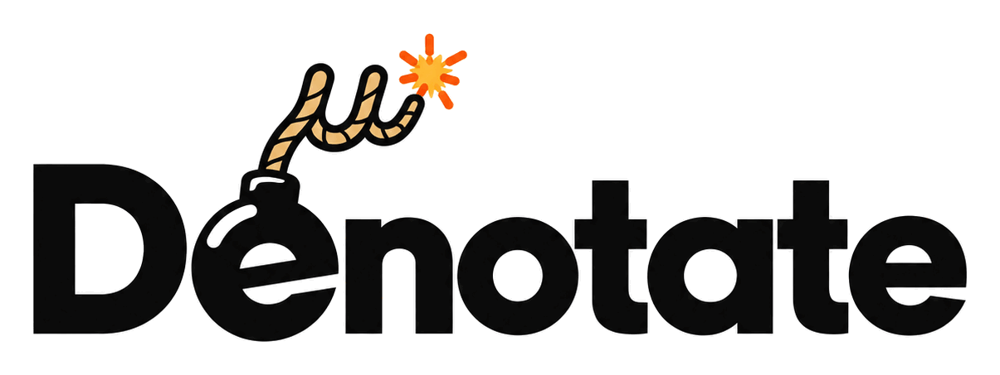

<h1 align="center"></h1>

Denotate is a semantic metalanguage: a language for defining the meaning of
domain-specific languages. A DSL designer writes its semantics as a Denotate
program - a reusable library of typed relations, facts, rules and contracts.

When someone writes a program in that DSL, its frontend translates the program
into additional Denotate facts and rules. These combine with the semantic library
to describe what the DSL program means. Evaluation, verification and compilation
can all work from this shared description.

The project grew out of experience building declarative languages for business
domains, where classifications, decisions, permissions and requirements need to
remain explicit and open to automated reasoning. Denotate lets DSL designers
express a language's meaning in a form that supports both execution and automated
reasoning. Each DSL retains its own vocabulary and authoring experience.

## A continuum of meaning

The language library defines the domain's concepts and rules. A program adds the
declarations and rules for a particular application. Input data supplies the
external facts for a particular evaluation.

All three contribute facts and rules to the same relational model. That model
describes both how a program behaves for a given input and what can be established
about its behavior before the input is known.

This shared model makes specialization possible: information already known about
the language and program can be resolved while input-dependent work remains.
Leaving inputs unspecified preserves a description of an entire class of possible
executions. Verification reasons about that class: it can prove that a property
holds across all permitted inputs within a stated scope, or identify an input
for which it fails.

Evaluation, verification and compilation become different uses of the same
model. Their governing requirement is agreement about the program's observable
behavior.

## What makes a program correct

Denotate's core semantics draw on logic programming: relations describe sets of
facts, and rules describe how new facts follow from those already established.

A program also describes a space of possible worlds. Each world represents a
possible input together with the consequences derived by the program. Assumptions
define which worlds are permitted; obligations state what must hold in them.

Together, assumptions and obligations express what it means for a program to be
correct. Verification asks whether the program's rules satisfy its obligations
throughout the permitted worlds. A world in which an obligation fails provides a
concrete counterexample, showing which inputs lead to the failure and what the
program derives from them.

The same model provides a foundation for verified refactoring - changing a
program's structure while proving that its observable behavior is preserved
across all permitted inputs within the chosen scope.

## An architecture built around meaning

Denotate builds on modern compiler techniques: typed intermediate representations
(IRs), explicit lowering steps and validation between layers. Lowering translates
a program into forms suited to analysis or execution. Each layer has an explicit
contract describing what it accepts, what it guarantees and which aspects of the
program's meaning it preserves.

DSL frontends bring their own syntax and domain vocabulary to a shared relational
IR. Semantic libraries define the domain concepts; evaluation, verification and
compilation build on the common model. This separation lets languages and backend
techniques evolve independently, with shared analysis reused across DSLs.

`.den` is both a language people can write directly and an interchange format that
DSLs can emit. It gives the shared IR a readable form in which library definitions,
translated programs and their relationships to source can be inspected and authored.

The IR provides a common foundation for combining reasoning techniques: binary
decision diagrams (BDDs), SAT and SMT solvers, and answer-set programming (ASP)
systems can contribute complementary analyses.
This lets a DSL benefit from different reasoning engines through the same semantic
definition.

The aim is a foundation on which programs can be evaluated, checked, transformed
and compiled with their meaning intact - and with explanations that remain connected
to what their authors wrote.

---

Code layout, setup and design documents: [DEVELOPMENT.md](DEVELOPMENT.md).
